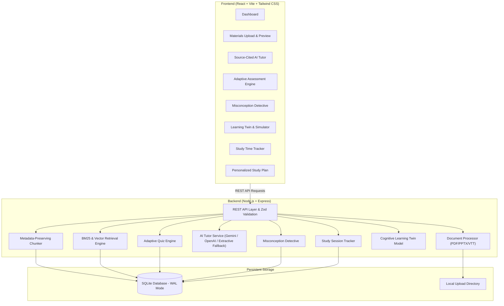

# AI StudyMate — Architecture & Technical Design

AI StudyMate is a full-stack, multimodal educational companion built for **Track D: Personalized Tutoring & Adaptive Learning | Multimodal AI Hackathon 2026**.

---

## 1. High-Level System Architecture

---

## 2. Key Architectural Pipelines

### A. Document Extraction & Metadata Preservation
* **PDF**: Extracts text with page-level boundary preservation via `pdf-parse` pagerender callbacks.
* **PPTX**: Direct XML extraction of `ppt/slides/slide*.xml` files via `adm-zip`, preserving sequential slide numbering.
* **Transcripts (VTT/SRT)**: Parses cues into timestamped segments (`00:00`, `02:30`, `05:15`) linking dialogue to video moments.
* **Chunking**: Sentence-boundary preserving chunker (target size ~1000 characters, ~150 character overlap) that tags every chunk with its exact material ID, title, unit label (`Page 2`, `Slide 4`, `02:30`), and inferred topic.

### B. Retrieval-Augmented Generation (RAG) & Fallback
* **Keyword & BM25 Scoring**: Inverse Document Frequency (IDF) + term saturation + topic matching.
* **Provider Flexibility**: Configurable Gemini or OpenAI integration via backend environment variables.
* **Deterministic Extractive Fallback**: If external LLM API keys are not supplied, synthesizes grounded answers directly from retrieved source passages with authentic citations. Never invents citations or hallucinations.

### C. Adaptive Assessment Engine
* Grounded question generation pairing each question with its originating chunk and unit label.
* **Calibrated Adaptive Rules**:
  * Accuracy $< 50\%$: foundational revision, beginner difficulty, topic tagged as `needs_improvement`.
  * Accuracy $50\% - 79\%$: targeted practice, intermediate difficulty, topic tagged as `practicing`.
  * Accuracy $\ge 80\%$: advanced problem solving, topic certified as `mastered` once $\ge 3$ questions are answered.

### D. Misconception Detective
* Captures incorrect answers and maps them to known conceptual fallacies or grounded topic contradictions.
* Pulls verifiable evidence from course materials.
* Formulates a follow-up verification challenge to confirm understanding and update mastery.

### E. Cognitive Learning Twin & What-If Simulator
* Digital twin profile computing topic mastery estimates and confidence scores based on sample size.
* What-If Simulator projecting prospective readiness deltas based on study hours and quiz practice, with scientific transparency disclaimers.

### F. Daily Study Time Tracker
* Real-time stopwatch persistent across browser refresh via local storage reconciliation.
* Server-side validated logging distinguishing live platform sessions from offline study.
